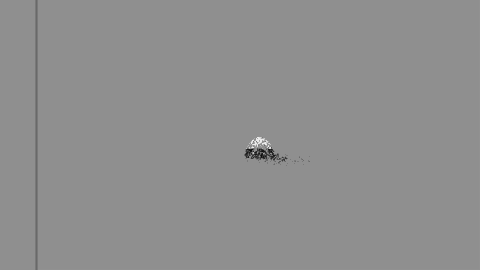

# Dust to Dust

A Frieren-style death animation for Foundry VTT — the body crumbles edge-to-edge into matte black dust that lingers a beat, then the wind scatters it away.

<p align="center">
  
</p>

## What it does

1. **Crumble** — a custom shader dissolves the token's artwork with a ragged, matte front. No glow.
2. **Dust** — particles spawn exactly where the token just crumbled, drift loose, then the wind takes over. Every fifth particle is a long-lived wisp trailing behind.
3. **Aftermath** — the token is hidden (default), kept as a corpse, or deleted. The GM sees hidden corpses ghosted at half opacity; players see nothing.

## Install

1. Download the module from the [latest release](https://github.com/XinSysVTT/dust-to-dust/releases/latest) (or drop the folder in your Foundry `Data/modules/` directory).
2. Enable **Dust to Dust** in your world's Module Settings.

## Quick start

- **Automatic** — leave *Death Trigger* on **Dead status on token** (default). On [Crucible](https://github.com/XinSysVTT/crucible) 0.10+ this catches every death: heroes at full wounds *and* adversaries at 0 health, because Crucible applies the core `dead` status in both cases. On other systems the generic adapter watches for the same status or common HP paths.
- **Manual** — hover a token and click the **wind icon** in the Token HUD, or use the macro API:

```js
await game.modules.get("dust-to-dust").api.play(token);          // by Token, TokenDocument, or id
await game.modules.get("dust-to-dust").api.play(token, {         // any setting can be overridden per play
  dissolveDuration: 3, windDirection: 180, afterEffect: "show",
});
```

`play()` resolves `true` when the effect finished, `false` when it was skipped (invalid target, already hidden, already dissolving). It never throws.

## Settings

| Setting | Default | Notes |
|---|---|---|
| Death Trigger | Dead status on token | `deadStatus` / `hpZero` / `manual` |
| Sweep Direction | Up (rises away) | `up` / `down` / `inward` |
| Dissolve Duration | 2.2 s | Time for the sweep to cross the token |
| Particle Density | 1.0 | Multiplier 0.2–3; also scales with token size |
| Wind Direction / Strength | 0° / 1.0 | 0° blows right, 90° down |
| Turbulence | 1.0 | Dust wobble and swirl |
| Particle Color | `#0a0a0a` | Near-black hex |
| After The Effect | Hide | Hide / keep corpse / delete (GM only, destructive) |

## Notes

- Every death animates at most once per token; already-hidden tokens are skipped.
- Targets Foundry v14 (14.366+) with its bundled Pixi 7.4.3; a Pixi 8 path is kept behind feature detection, and any API mismatch degrades to a plain alpha fade so the game never breaks.
- Document mutations (hide/delete) are issued by users who own the token; other clients simply play the visuals and follow the broadcast state.
